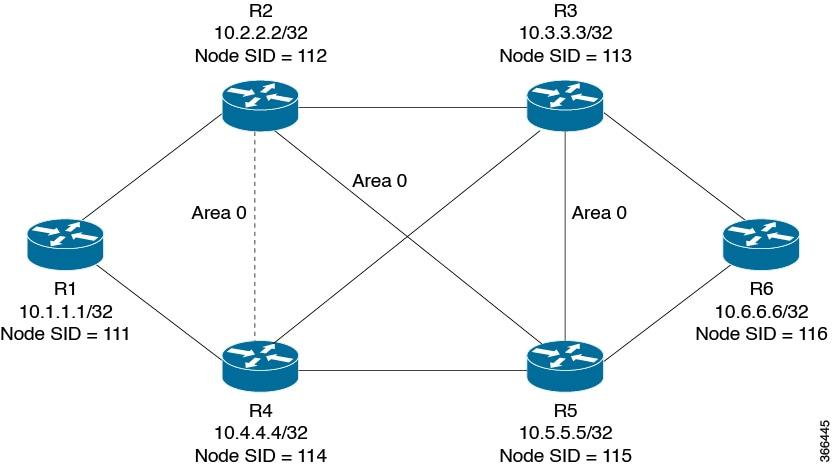

# Task 5 – Open Shortest Path First (OSPF)

## Objective

To understand OSPF routing, calculate interface costs, apply Dijkstra's shortest-path algorithm, configure OSPF in Cisco Packet Tracer, and compare OSPF with other routing protocols.

## 1. OSPF Cost Calculation

OSPF calculates interface cost using:

**OSPF Cost = Reference Bandwidth / Interface Bandwidth**

The default reference bandwidth is 100 Mbps.

| Interface Bandwidth | Default OSPF Cost |
|---|---:|
| 10 Mbps | 10 |
| 100 Mbps | 1 |
| 1 Gbps | 1 (minimum integer cost) |
| 10 Gbps | 1 (minimum integer cost) |

With faster networks, the default reference bandwidth may not distinguish between high-speed interfaces.

A new reference bandwidth of 10,000 Mbps (10 Gbps) is selected.

| Interface Bandwidth | New OSPF Cost |
|---|---:|
| 10 Mbps | 1000 |
| 100 Mbps | 100 |
| 1 Gbps | 10 |
| 10 Gbps | 1 |

The same reference bandwidth must be configured on all OSPF routers.

## 2. Dijkstra's Shortest Path Algorithm

A six-router topology is used to calculate the shortest paths from R1.

- [Dijkstra Calculations](Calculations/dijkstra.md)

## 3. OSPF Configuration

OSPF is configured using process ID 1 and Area 0.

- [OSPF Router Configurations](Configurations/OSPF.txt)
- [Packet Tracer Simulation](PacketTracer/ospf_six_router.pkt)

The topology uses eight links connecting six routers. Interface costs are configured to match the link weights used in the Dijkstra calculation.

## 4. OSPF Areas

OSPF supports hierarchical routing using areas.

- Area 0 is the backbone area.
- Smaller networks can use a single area.
- Larger networks can use multiple areas to reduce routing information and improve scalability.

For this six-router topology, all routers are placed in Area 0.

## 5. OSPF vs EIGRP vs IS-IS

| Parameter | OSPF | EIGRP | IS-IS |
|---|---|---|---|
| Algorithm | Dijkstra | DUAL | SPF / Dijkstra |
| Metric | Cost | Bandwidth and delay by default | Configurable metric |
| Standard | Open standard | Originally Cisco-developed; now documented openly | Open standard |
| Hierarchy | Areas | Autonomous systems | Levels and areas |
| Convergence | Fast after SPF calculation | Fast with feasible successors | Fast after SPF calculation |

OSPF uses cost to select paths. EIGRP uses a composite metric based mainly on bandwidth and delay with default settings. IS-IS uses configurable link metrics and supports hierarchical routing.

## 6. Verification and Evidence

The following commands are used:

```bash
show ip ospf neighbor
show ip route
show ip ospf interface
show ip protocols
ping
traceroute
```

Evidence screenshots are stored in:



| Evidence File | Description |
|---|---|
| topology.png | Six-router Packet Tracer topology |
| ospf_costs.png | OSPF cost configuration |
| ospf_neighbors.png | OSPF neighbour relationships |
| routing_table.png | OSPF routing table |
| ping_test.png | Successful connectivity test |

## Conclusion

OSPF is a link-state routing protocol that uses Dijkstra's algorithm to calculate shortest paths. Choosing an appropriate reference bandwidth allows OSPF to distinguish between modern high-speed links. Areas provide a scalable way to organise larger networks.